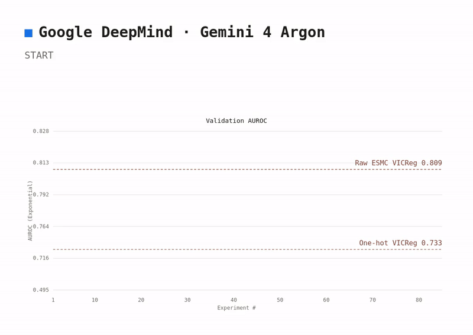
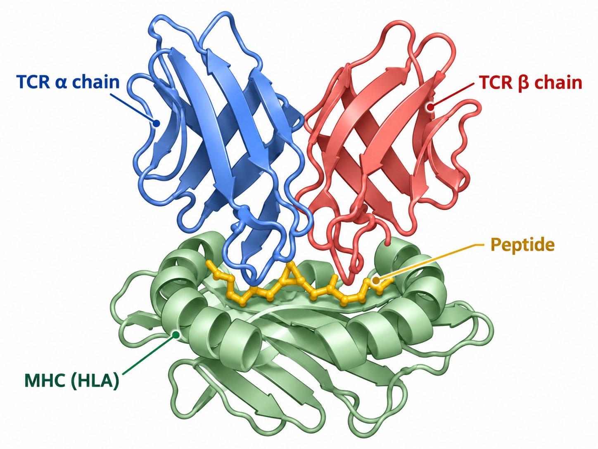
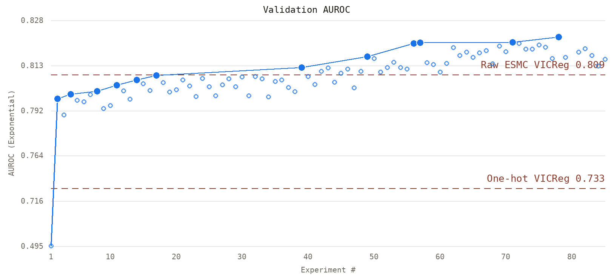
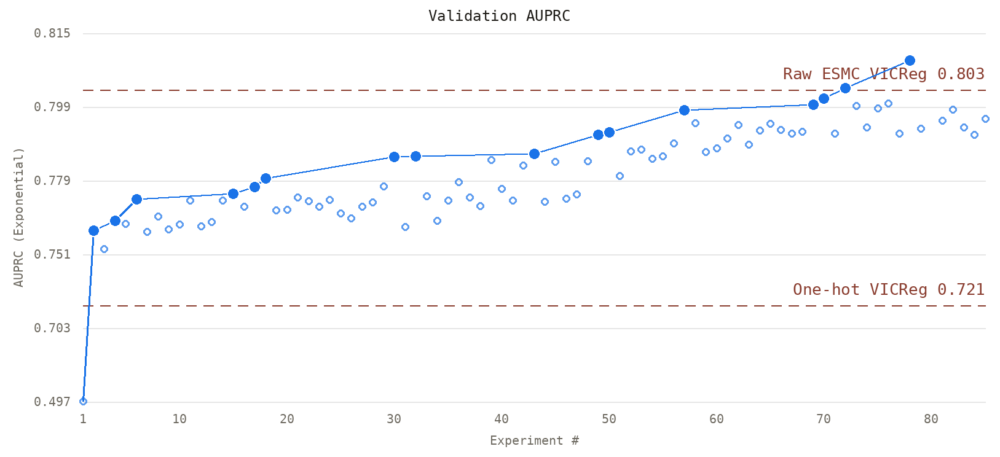

# Autonomous Research for TCR–pMHC Binding

## TCR-pMHC Binding - The Marker of Immunity

The immune system uses T-cell receptors (TCRs) to recognise potentially harmful cells, such as viruses and cancer. Cells display small fragments of proteins, called peptides, on their surface using molecules known as MHCs, forming peptdie-MHC (pMHC) complexes. When a TCR binds to a specific pMHC complex, it signals that the T cell has recognised its target and can trigger an immune response. Predicting which TCRs bind to which pMHC complexes is therefore a fundamental step towards understanding and harnessing the immune system.





## Why this matters

If we could reliably predict which TCRs bind to which antigens, it would have major implications for **cancer immunotherapy**, **autoimmune disease**, **infectious disease monitoring**, and **personalised vaccine design**.

Potential applications include:

- **Personalised cancer vaccines**: prioritising peptides most likely to be immunogenic.
- **Disease monitoring**: identifying TCR signatures associated with infection, tumour response, or immune dysfunction.
- **Autoimmune research**: understanding unwanted TCR recognition of self-like peptides.
- **Therapeutic discovery**: accelerating peptide-specific TCR discovery and screening.

## Why it is hard - and why we need ML

The scale and complexity of TCR–pMHC recognition makes exhaustive experimental testing impossible. In recent years, researchers have therefore shifted towards developing predictive ML models.

Enormous diversity: over 10¹⁵ theoretically possible TCRs, with only a fraction experimentally characterised.

Complex binding: hypervariable CDR loops within the TCR and flexible docking geometries make molecular recognition difficult to predict.

Immune escape: even single amino-acid mutations can disrupt recognition, allowing viruses and tumours to evade immunity.

Sparse, biased data: limited experimental observations make it difficult for models to generalise to unseen interactions.

The challenge is to learn transferable rules of molecular recognition, rather than memorise known binding pairs.

## Our thesis

We are testing whether **Gemini 4 Argon** can act as an autonomous research scientist for this problem.

The agent is given:
- a fixed dataset of TCR–pMHC sequence pairs,
- an initial modelling file (`ml.py`),
- a fixed evaluation pipeline (`eval.py`),
- and an experiment log capturing prior hypotheses, edits, results, and decisions.

Argon then iteratively:
1. proposes a scientifically motivated modelling change,
2. edits **only** `ml.py`,
3. runs training and evaluation,
4. reads the resulting metrics and updated experiment log,
5. updates its reasoning using the **large context window**, and
6. decides what to try next.

The focus is contextual scientific iteration, not only model optiminsation: each experiment is informed by the growing research history, allowing the agent to build hypotheses cumulatively rather than treating each run in isolation.

## Sequence baselines

These VICReg models were trained before the autonomous search, on the same complete α+β cohorts the evaluator scores.

| Model | Val AUROC | Val AUPRC | Test AUROC | Test AUPRC |
| --- | --- | --- | --- | --- |
| One-hot VICReg | 0.733 ± 0.002 | 0.721 ± 0.003 | 0.721 ± 0.003 | 0.705 ± 0.004 |
| Raw ESMC VICReg | 0.809 ± 0.004 | 0.803 ± 0.003 | 0.789 ± 0.004 | 0.787 ± 0.004 |





## Research goal

Our immediate aim is to improve **validation performance under scientifically defensible evaluation**, while generating a transparent record of:
- what was changed,
- why it was changed,
- what happened,
- and whether the evidence supports keeping the modification.

More broadly, this project asks a simple but important question:

> Can a frontier model use long-context experimental memory to conduct meaningful, iterative machine learning research on a hard biological problem?

## Data provenance

This work draws on curated TCR–epitope resources including:
- **IEDB**: Vita et al., *Nucleic Acids Research* (2025)
- **VDJdb**: Goncharov et al., *Nature Methods* (2022)
- **tcrdist3-related public SARS-CoV-2 TCR analyses**: Mayer-Blackwell et al., *eLife* (2021)

## Repository structure

- `ml.py` — the **only** model file the agent may modify
- `eval.py` — fixed evaluation logic for model and agent assessment
- `objective.md` — the agent’s research brief
- `experiments/` — logs, results, summaries, and progress plots

## Run

Set `GEMINI_API_KEY` or `OPENROUTER_API_KEY`, plus `TRAIN_PATH` and `VALIDATION_PATH`, in `.env`. Gemini 4 Argon is the default. `--resume` reopens the latest session.

```bash
python agent/agent.py --max-experiments 2
python agent/agent.py --resume
```

Final evaluation reads `TEST_PATH` and then freezes that session, so a later resume cannot use the test labels.

```bash
python final_eval.py --test-path /absolute/path/to/test.csv --session SESSION --experiment-id 0001
```

## Bottom line

TCR–pMHC binding prediction sits at the intersection of **machine learning, structural biology, and immunology**, with direct relevance to cancer, autoimmunity, infection, and precision therapeutics.

This repository explores whether autonomous long-context reasoning can move that problem forward.
